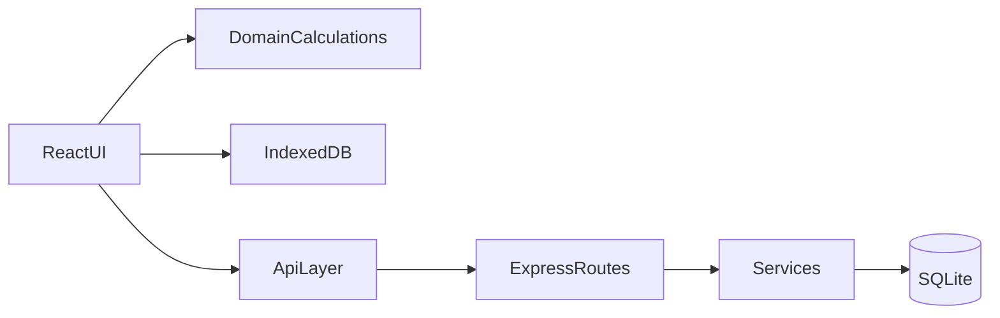
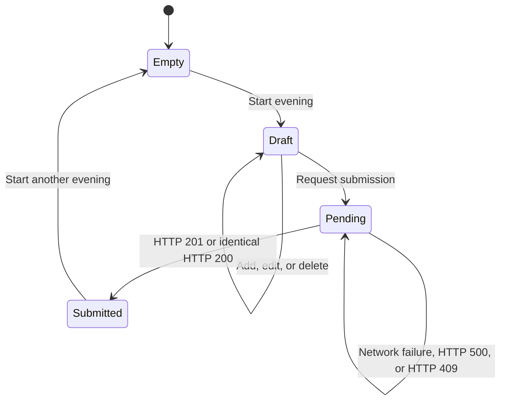
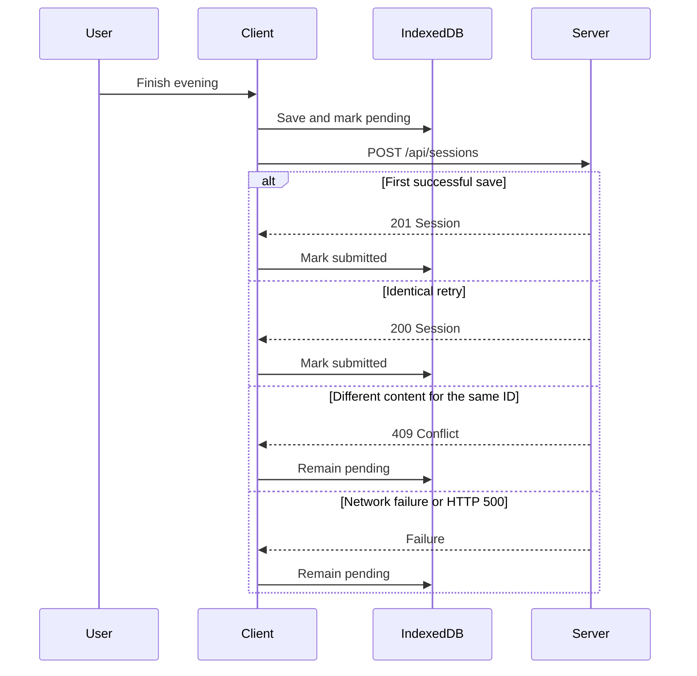

# Architecture

Poker Tracker is two deployable parts that share one HTTP contract.



The React UI calls domain functions for balances and calls the API layer for players and completed sessions. Components do not call `fetch`, contain SQL, or recalculate money with ad hoc expressions.

## Responsibilities

| Concern | Client | Server |
| --- | --- | --- |
| Active evening and draft transactions | Owns | Does not see drafts |
| Balances, totals, rankings, and statistics | Calculates | Does not calculate |
| Player directory | Selects and displays | Stores and validates |
| Completed sessions | Submits and reviews | Stores atomically and returns |
| Idempotency and foreign keys | Reuses the same session ID | Enforces |

A session participant is any distinct player referenced by that session's transactions. Version 1 has no separate attendance record.

## Client structure

```text
client/src/
  main.tsx
  app/                 # shell, routes, navigation
  domain/              # models, validation, calculations
  data/local/          # IndexedDB
  data/api/            # HTTP boundary
  features/players/
  features/sessions/
  styles/              # tokens and global RTL styles
```

Domain code stays independent of React, IndexedDB, and HTTP.

The bottom navigation bar has three destinations. Nested paths stay on the parent item.

| Route | Hebrew label | Purpose |
| --- | --- | --- |
| `/` | ערב נוכחי | Record the active evening |
| `/history` | היסטוריה | Browse completed evenings |
| `/history/:sessionId` | היסטוריה | Read-only summary of one evening |
| `/history/:sessionId/transactions` | היסטוריה | Transactions for that evening |
| `/history/:sessionId/players/:playerId` | היסטוריה | That player's transactions in the evening |
| `/stats` | סיכומים | Group overview, ranking, and charts |
| `/stats/:playerId` | סיכומים | One player's progression across evenings |

Player management opens from the current evening and the transaction sheet. It is not a primary navigation item. The statistics screen shows the completed-evening count, the transaction count, ranking with evenings played, a results-by-session chart, and a player-comparison chart. A player's page adds the cumulative-result chart.

## Local session lifecycle

IndexedDB stores one active session record. Its status is local and is never sent to the server.



Rules:

- Persist the active session before the interface treats a transaction change as complete.
- Keep the same session ID from the first local save through every submission retry.
- Do not start another evening while the status is `draft` or `pending`.
- After `submitted`, retain the local copy until the user explicitly starts another evening.
- A failed or uncertain submission leaves the status `pending` and leaves every transaction in IndexedDB.



The server compares a retry by session ID, session date, and the set of transactions. Transaction order is not significant. Timestamps match when they represent the same UTC instant. `createdAt` is server-owned and is not part of the comparison.

## Server structure

```text
server/src/
  index.ts             # process entry
  app.ts               # Express application
  config.ts            # port, SQLite path, CORS origin
  routes/              # HTTP parsing and status codes
  services/            # player and session operations
  db/                  # connection, schema, SQL
  schemas.ts           # Zod schemas
  http/                # JSON error document
```

Routes validate input, call one service, and translate the result to HTTP. Services coordinate database transactions. Database modules own SQL. There is no repository framework and no dependency-injection framework.

Session creation inserts the session and all of its transactions in one SQLite transaction. Any failure rolls the entire operation back.

## Locked decisions

These decisions close gaps in the source specifications.

1. The server generates player IDs. The client generates session and transaction IDs.
2. Transaction timestamps use RFC 3339 date-time values, including `Z` or a numeric offset. The offset-free examples in the server specification are illustrative only.
3. The first successful `POST /api/sessions` returns `201`. An identical retry returns `200` and the stored session. Different content for an existing session ID returns `409`.
4. Financial totals exist only in the client. API responses do not add balances, profit, or statistics.
5. Player names may be duplicated. The client warns when another player has the same trimmed name under Hebrew base comparison. The server trims and collapses internal whitespace, then stores the name without a uniqueness constraint.
6. Creating a player requires the server. The client caches the last successful player list for selection during a connectivity gap. Version 1 does not create local-only players, because submission would fail for an unknown player ID.
7. Completed sessions are read-only. Version 1 has no session update or delete API.
8. The default session date is the device-local calendar date in `YYYY-MM-DD`.
9. Amounts are positive whole currency units. Version 1 stores no currency code. The interface formats them with Hebrew grouping and an explicit `+` or `−` sign, without a currency symbol.
10. The current evening shows the five newest transactions and links to the complete history.
11. A player row opens that player's transactions for the current evening. Recording uses a bottom sheet. The main add action starts with no player selected; add from a player's details preselects that player. After a successful save, the sheet stays open, the amount clears, and the selected player and type remain selected.
12. An immediate undo removes the transaction just saved. Edit and delete remain available for every draft transaction.
13. Finishing an evening requires at least one transaction. The server still accepts an empty transaction list.
14. A `409` response preserves the local session and its ID. The interface explains that the server already holds different content for that evening.

## Hebrew terminology

| Concept | Hebrew |
| --- | --- |
| Session | ערב |
| Current session | ערב נוכחי |
| Player | שחקן |
| Transaction | פעולה |
| Buy-in | כניסה |
| Rebuy | כניסה נוספת |
| Cash-out | יציאה |
| Balance | מאזן |
| History | היסטוריה |
| Summary | סיכום |
| Statistics | סיכומים |

Local status labels are `פתוח` for draft, `ממתין לשליחה` for pending, and `נשלח` for submitted.

## Visual baseline

The visual source is [specs/Visual Design Language.md](../specs/Visual%20Design%20Language.md). The interface is light, rounded, and mobile-first, with Heebo, generous spacing, and green as the action accent. Positive amounts use `#249B45`, negative amounts use `#D94B4B`, and the sign is always visible as well. Layout uses CSS logical properties and supports a 360px-wide viewport and mobile safe areas.
